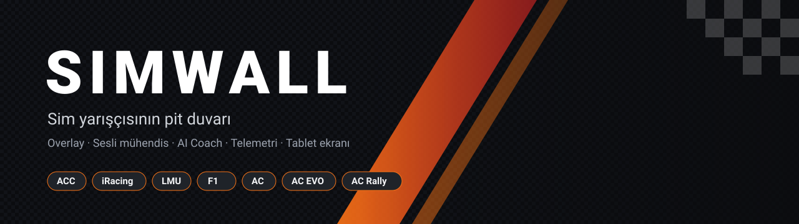

  

  
  
  
  

  <b><a href="https://formulabey-web.vercel.app/indir">⬇ İndir</a></b> &nbsp;·&nbsp;
  <a href="https://formulabey-web.vercel.app">Web sitesi</a> &nbsp;·&nbsp;
  <a href="https://www.youtube.com/@formulabey">YouTube</a>

---

> **Simwall nedir?** Oyunla birlikte arka planda çalışan, ekrana bilgi koyan, kulağına konuşan ve yarıştan sonra seni neyi düzelteceğin konusunda bilgilendiren bir pit ekibi. Kurulum iki dakika, oyunu kendisi bulur.

## 🏁 Bir yarış haftasonu Simwall ile

| | Ne olur |
|---|---|
| **🛠️ Antrenman** | AI Coach her turu kaydeder, virajları tek tek inceler: *"5. virajda fren 20 metre erken, çıkışta gaza geç basıyorsun."* Setup analizi lastik basıncından fren dengesine öneri verir. Ekrandaki fren noktası sana nerede fren yapacağını gösterir. |
| **⏱️ Sıralama** | Delta bar, sektör süreleri ve en iyi turunla canlı fark. Telefonun direksiyon ekranına dönüşür. |
| **🏎️ Yarış** | Sesli mühendis telsizden konuşur: yakıt kaç tur yetiyor, öndeki yaklaşıyor mu, bayraklar, pit penceresi. Spotter yanındaki aracı söyler. Takım arkadaşın pit servisini uzaktan ayarlar. Sorunu direksiyon düğmesine bağla: *"Yakıt ne durumda?"* |
| **📊 Sonrası** | Telemetri analizinde turlarını üst üste koy, 3D pistte hayalet araçla karşılaştır, kaybettiğin bölümü A–B ile işaretle. Yarış sonucu ekranında podyum ve kazandığın sıralar. |

## ✨ Öne çıkanlar

<table>
  <tr>
    <td width="50%" valign="top">
      
      <h3>Canlı pit duvarı</h3>
      Delta, sektörler, çok sınıflı sıralama, pist haritası, kapışma. Strateji sekmesinde pit planı, pitten çıkış pozisyonu, lastik trendi ve yağmur tahmini.
    </td>
    <td width="50%" valign="top">
      
      <h3>60'tan fazla overlay</h3>
      Relative, radar, kör nokta, delta bar, yakıt, lastik, hasar, F1 kulesi, ERS / aero. Oyuna, araca ve seansa göre otomatik profil. <code>F10</code> gizle, <code>Ctrl+F10</code> kilitle.
    </td>
  </tr>
  <tr>
    <td width="50%" valign="top">
      
      <h3>Telefon ve tablet ekranı</h3>
      QR kodla telefonun ya da tabletin direksiyon ekranı olur. Button Box ile oyuna tuş gönder, Simwall Studio'da kendi ekranını tasarla, SimHub dash'larını içe aktar.
    </td>
    <td width="50%" valign="top">
      
      <h3>Arkadaşlar ve takım</h3>
      Arkadaşının seansını canlı izle, mesajlaş, takım kur, ses odalarında konuş. Düzenleri ve dash'ları toplulukla paylaş.
    </td>
  </tr>
</table>

## 🎮 Oyunlar

| | Overlay | Sesli mühendis | AI Coach | Oyuna özel |
|---|:---:|:---:|:---:|---|
| **Assetto Corsa Competizione** | ✅ | ✅ | ✅ | Broadcasting ile canlı sıralama, tek tıkla kurulum |
| **iRacing** | ✅ | ✅ | ✅ | Canlı sıralama, iRating kıyası, .ibt telemetri analizi |
| **Le Mans Ultimate** | ✅ | ✅ | ✅ | Sanal enerji, aşınma, pit süresi tahmini, yağmur ihtimali |
| **F1 25 / 24 / 23** | ✅ | ✅ | ✅ | ERS, DRS, hasar, cezalar; PlayStation / Xbox'tan da (aynı ağ) |
| **Assetto Corsa / AC EVO / AC Rally** | ✅ | ✅ | ✅ | |

## 🚀 Kurulum

1. [Son sürümü](https://formulabey-web.vercel.app/indir) indir, kurulumu çalıştır, güvenlik duvarı iznini ver.
2. Oyunu **kenarlıksız / pencereli tam ekran** modunda aç (Windows özel tam ekranın üstünde overlay göstermez).
3. F1'de UDP telemetriyi aç; diğer oyunlarda bir şey yapma.
4. Overlay'leri yerleştir, **Ctrl + F10** ile kilitle ve sür.

## 💎 Ücretsiz ve Pro

| | Ücretsiz | Pro |
|---|:---:|:---:|
| Overlay'ler, sesli mühendis, AI Coach, telemetri analizi | ✅ | ✅ |
| Aynı bilgisayar / aynı ağdan tablet ekranı, Button Box | ✅ | ✅ |
| Yarış takvimi, arkadaşlar, mesajlar | ✅ | ✅ |
| Uzaktan mühendis (internet üzerinden) | | ✅ |
| Arkadaşının seansını canlı izleme | | ✅ |
| Bulut seans geçmişi | | ✅ |

Yeni hesaplar **30 gün Pro** ile başlar. Davet kodunla gelen arkadaşların sana **Elçi** rozeti ve komisyon kazandırır.

## ❓ Sık sorulanlar

<b>Overlay'ler oyunda görünmüyor</b>

Oyunu kenarlıksız ya da pencereli tam ekranda çalıştır. Hâlâ görünmüyorsa <code>F10</code> ile göster, <code>Ctrl+F10</code> ile kilitle.

<b>FPS'imi düşürür mü?</b>

Simwall telemetriyi okur ve sadece açık overlay'leri çizer; kapalı overlay için hesap yapılmaz. Overlay'ler kilitliyken fare tıklamaları doğrudan oyuna gider.

<b>Konsolda çalışır mı?</b>

F1 oyunlarında evet: konsoldaki UDP telemetriyi bilgisayarın IP'sine gönder, Simwall'da Bağlantı → F1 → "Başka cihazdan al"ı aç.

<b>Hesap açmak zorunlu mu?</b>

Arkadaşlar, bulut ve davet özellikleri için hesap gerekir. Hesap e-posta, Google, Discord ya da Twitch ile açılabilir.

---

  FormulaBey tarafından Türk sim yarış topluluğu için geliştiriliyor · Destek: formulabey@gmail.com

Bu depo sadece kurulum dosyalarını barındırır; uygulama yeni sürümleri buradan kendisi bulur. 2.2.13'e kadar adı FormulaBey Companion'dı. Copyright © 2026 FormulaBey. Tüm hakları saklıdır. Bkz. <a href="LICENSE.txt">LICENSE.txt</a>. iRacing, Assetto Corsa Competizione, Le Mans Ultimate, EA SPORTS F1 ve Assetto Corsa ilgili şirketlerin ticari markalarıdır. Simwall bu şirketlerle bağlantılı değildir.

